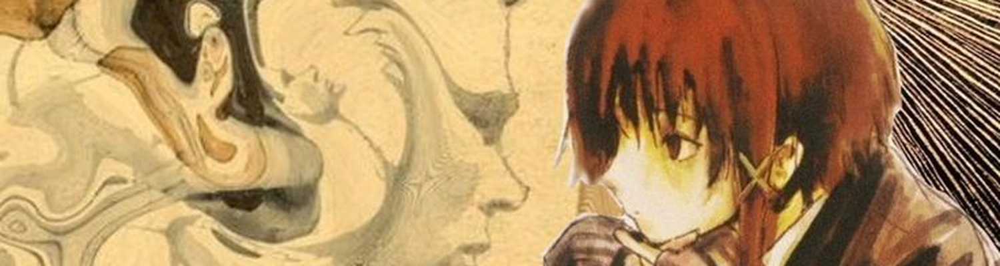

<h1 align="center">nerovalue</h1>

  

  

## ✧ Projects

Secret for now

## ✧ Stack

**Frontend** HTML · CSS · JavaScript · TypeScript · React · Next.js 
**Backend** Node.js · Express · Python 
**Systems** Rust · C · C++ · Assembly 
**Data And Tools** PostgreSQL · MongoDB · Docker · Git · Linux

  

## ✧ Activity

  

  

